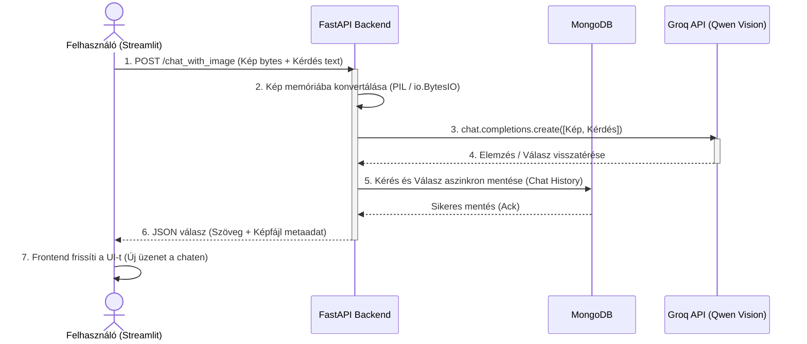

# Projekt előrehaladása

### 📌 Elvárások a beadandóval kapcsolatban:
* **Patch (Minimum szint):** A meglévő projekt leágaztatása (forkolása) és átültetése egy másik környezetbe (például Groq alapokra)
* **Minor (Középszint):** A meglévő funkciók továbbfejlesztése és kiegészítése (például RAG-alapú kontextusbevonás a képelemzés során).
* **Major (Haladó szint):** Teljesen új funkció vagy alrendszer implementálása (például a WALDO finder modul felépítése).

### 📌 Összegzés a beadandó struktúrájához:
* **Patch (Minimum):** Groq LPU migráció (Gemini lecserélése, aszinkron kliens). Forkolás linkje: https://github.com/laszlokmobile-design/complex-ai-applications
* **Minor (Közép):** Több kép egyidejű feltöltése és feldolgozása a Gépi Látás (Vision) modulban (*Multi-image support*).
* **Major (Haladó):** A **Waldo Kereső modul** (5. fül, PIL rajzolás, Regex koordináta-kinyerés, aszinkron `ThreadPoolExecutor` folyamatkövetés).
---

# Komplex MI alkalmazások fejlesztése

A projekt célja, hogy a hagyományos "Jupyter Notebook" szintű kísérletezésen túllépve, egy valós, skálázható szoftverarchitektúrát hozzunk létre, amely egy FastAPI backendből, egy Streamlit frontendből, valamint több adatbázisból áll.

---

##  RAG és a "Memória"

A modern Nagy Nyelvi Modellek (LLM-ek, mint a Llama vagy Qwen) lenyűgözőek, de van két komoly kihívás velük kapcsolatban:
1. **Nincs friss/privát tudásuk:** Nem látnak bele a vállalatod belső dokumentumaiba.
2. **"Amnéziásak":** Minden HTTP kérést tiszta lappal kezdenek, nem emlékszenek az egy perccel ezelőtt feltett kérdésedre.

Ezt a két problémát oldjuk meg az architektúránkkal:

### 1. RAG (Retrieval-Augmented Generation) és Vektorok
A saját dokumentumainkat vektorokká (számsorozatokká) alakítjuk az **Embedding** technológia segítségével, és egy **ChromaDB vektoradatbázisban** tároljuk. Amikor a felhasználó kérdez, a rendszer megkeresi a leginkább releváns bekezdéseket a térben, és ezt "puskaként" átadja a modellnek.

### 2. Állapottartó (Stateful) Beszélgetés és NoSQL
Ahhoz, hogy a gép emlékezzen a beszélgetés fonalára, bevezettünk egy **MongoDB (NoSQL) adatbázist**. 
* **Miért NoSQL?** Az MI-vel folytatott beszélgetések (kiküldött promptok, kapott válaszok, metaadatok) természetes módon JSON/dokumentum formátumúak, amire a MongoDB tökéletes választás. A relációs adatbázisok (SQL) ehhez túl merevek lennének.
* A rendszer generál egy `session_id`-t, és minden üzenetváltást letárol, így a következő kérdésnél a FastAPI a teljes beszélgetési előzményt fel tudja tölteni a modell memóriájába.

---

## Technológiai Stack és Architektúra

A projekt a legmodernebb ipari standardokra (Docker Compose) épül:
* **Környezet:** Docker DevContainer (Python App + MongoDB konténerek közös hálózaton).
* **Backend:** `FastAPI` (Aszinkron API), `Motor` (Aszinkron MongoDB driver) és `Pillow` (Memórián belüli képkezelés).
* **Frontend:** `Streamlit` (Modern, Python-alapú chat UI).
* **Adatbázisok:** `ChromaDB` (vektoroknak) és `MongoDB` (munkameneteknek és chat logoknak).
* **MI Integráció:** `groq` Python SDK (`AsyncGroq` és Qwen multimodális modellek).

---

## Fejlesztői Környezet Indítása

### 1. Előfeltételek és Beállítások

A projekt futtatásához kétféle módszer közül választhatsz:

### A) Docker-alapú futtatás (Ajánlott és leggyorsabb, indítószkript: start.bat)
- **Docker Desktop**: Futnia kell a gépeden (ez automatikusan felhúzza és kezeli a MongoDB adatbázist a háttérben).
- **Python 3.10+**: A helyi szkriptekhez és a Streamlit frontendhez.
- **Groq API Kulcs**: Szerezz be egyet a [Groq Console](https://console.groq.com/)-ról és írd be a .env fájlba.

### B) Lokális futtatás (Docker nélkül, a `start.py` szkripttel)
- **MongoDB**: Helyileg telepítve kell lennie a gépeden (és futnia kell a `localhost:27017` porton).
- **Python 3.10+**: A helyi szkriptekhez és a Streamlit frontendhez.
- **Groq API Kulcs**: Szerezz be egyet a [Groq Console](https://console.groq.com/)-ról és írd be a .env fájlba.
  
```env
GROQ_API_KEY=gsk_saját_groq_kulcsod_ide
```

## 2. Csatlakozás a MongoDB-hez (VS Code Plugin)
Nem kell vaktában kódolnod! A DevContainer tartalmaz egy hivatalos MongoDB kiterjesztést.

Kattints a VS Code bal oldali sávjában a MongoDB (falevél) ikonra.

Kattints az Add Connection gombra.

A fenti parancssorba írd be: mongodb://mongo:27017 majd nyomj Entert.
> (Megjegyzés: A Docker belső hálózata miatt a host nevünk mongo, nem pedig localhost!)

## 3. A Szolgáltatások Futtatása (start.py vagy start.bat)

A programoz készült kettő darab indító szkript is.
**start.py**, amely egyszerre indítja a frontendet és a backendet az alkalmazás gyökérmappájában található. Ez automatikusan megnyitja a böngészőben a Streamlit alkalmazást (jellemzően a http://localhost:8501 címen). Az alkalmazás korlátlan működéséhez ekkor szükség van egy telepített MongoDB futtatáshoz is.
**start.bat** futtatásához Docker

### 4. Multimodális Gépi Látás (Vision)
A rendszer képes képeket (számlákat, diagramokat, vizuális adatokat) fogadni és feldolgozni a Qwen modell segítségével, ami közvetlenül strukturált adatokat vagy elemzést generál a bináris fájlokból.

###  Az Adatfolyam Vizualizációja (Multimodális Látvány)
Az alábbi ábra bemutatja, hogyan utazik egy képes-szöveges kérés a kliensgéptől egészen az MI szerveréig és vissza:


## Project struktúra

```
/
├── start.py                # Egységes indító szkript (Backend + Frontend)
├── start.bat               # Docker indító szkriptje
├── src/
│   ├── backend/          
│   │   └── api.py          # FastAPI végpontok (RAG, Chat és Vision logika)
│   └── client/
│       └── app.py          # Streamlit UI (Feltöltés, Chat és Waldo modul)
├── chroma_db/              # Lokális vektoradatbázis (automatikusan létrejön)
├── requirements.txt        # Függőségek (FastAPI, Streamlit, motor, chromadb, groq stb.)
├── docker-compose.yml
├── Dockerfile
└── .env                    # API kulcsok (NE KÜLDD BE GITHUB-RA!)
```
---

## ⚠️ Ismert jelenségek és hibatűrés (Groq LPU Alapokon)

Mivel az alkalmazás a **Groq felhőszolgáltatására** és a **Qwen multimodális modellekre** támaszkodik, előfordulhatnak átmeneti terhelési tüskék vagy korlátozások:

- **HTTP 429 (Rate Limit / Túl sok kérés):** 
  A Groq API percenkénti kérés- (RPM) vagy tokenkorlátba (`TPM`) ütközhet, ha túl sűrűn küldesz kéréseket (különösen nagy méretű képek elemzésekor). 
  * *Megoldás:* Várj 10-20 másodpercet, amiből a token-kvóta automatikusan feltöltődik, majd próbáld újra.
  
- **HTTP 503 / 502 (Szerveroldali leterheltség):** 
  A Groq LPU szerverei vagy a modell hosztolása átmenetileg nem elérhető. 
  * *Megoldás:* A kódodban lévő `tenancy` retry mechanizmus automatikusan megpróbálja újra 3 alkalommal, de ha manuálisan is hibát kapsz, ismételd meg a műveletet pár másodperc múlva.

- **Képformátum vagy méret hiba:** 
  Ha a feltöltött képnél hiba lép fel, ellenőrizd, hogy a fájl kiterjesztése szabványos `jpg`, `jpeg` vagy `png` legyen, és a fájlméret ne lépje túl a megengedett kereteket.
